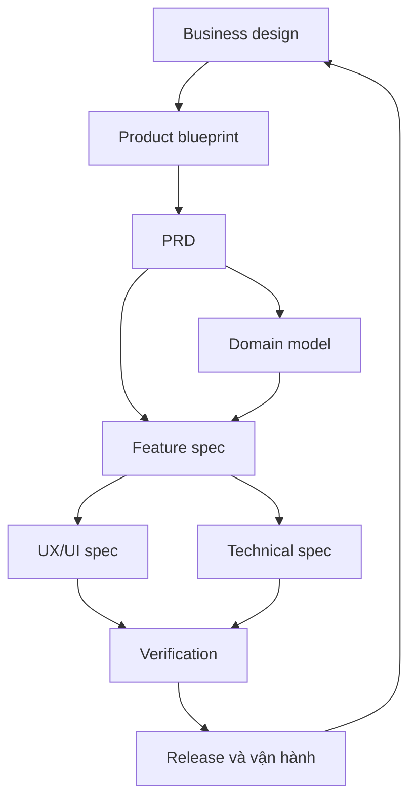

# Hệ thống tài liệu sản phẩm — C2O Design v1.5

Đây là bộ tài nguyên tùy chọn để giữ quyết định từ business đến implementation có thể tìm, kiểm tra và cập nhật trong vòng làm việc C2O hiện có. [Outcome contract](../../../references/outcome-contract.md), nguồn scope/acceptance/evidence đã chọn và quyền hiện có tiếp tục giữ thẩm quyền. Tác vụ nhỏ có thể ở trong hội thoại; không cần `.design`, JSON, index hay metadata. Tài liệu có thể là section của artifact hiện hữu hoặc file riêng khi hữu ích; không để hai nơi cùng định nghĩa một quy tắc.

v1.3 đã có brief, experience, options/decision, baseline, layout, component, data view, screen, asset plan và evidence records. v1.4 bổ sung business/product/domain/technical/delivery/release templates. v1.5 áp dụng [chuẩn template 1.0](template-standard.md) cho source của 24 mẫu catalog Markdown: metadata, input/output, ownership và checklist bàn giao. Bản tích hợp nâng từng template lên 1.1.0 để làm rõ cách dùng tùy chọn; chuẩn cấu trúc catalog vẫn là 1.0.0 và không áp đặt metadata lên tài liệu dự án. [Registry](template-registry.json) giữ danh mục/phiên bản mẫu. Các phần này không thay thế hợp đồng UI đang có hoặc thêm chuỗi phê duyệt bắt buộc.

## 1. Phân biệt các tên tài liệu

| Tài liệu | Câu hỏi nó chịu trách nhiệm | Không nhận thêm trách nhiệm |
| --- | --- | --- |
| Business design | Phục vụ ai, giá trị gì, tiếp cận thế nào, ai trả tiền hoặc tài trợ, chi phí và giả thuyết nào cần kiểm tra? | Không định nghĩa schema hay xác nhận đã có product-market fit |
| Product blueprint | Sản phẩm gồm actor, capability, flow, domain, màn và platform nào; phần nào nằm ngoài ranh giới? | Không chép toàn bộ chi tiết của từng feature/spec |
| PRD | Phiên bản này phải mang lại kết quả nào, có/không có yêu cầu nào và vì sao ưu tiên? | Không phải thiết kế database hoặc danh sách ticket thuần kỹ thuật |
| Domain model | Đối tượng, identity, quan hệ, nghiệp vụ và lifecycle nghĩa là gì? | Không đồng nhất với bảng SQL hoặc mọi thuộc tính UI |
| Feature spec | Một feature thực hiện thế nào dưới điều kiện, hành động, nhánh lỗi và kết quả cụ thể? | Không tạo lại business rules đã có nguồn chuẩn |
| UX/UI spec | Người dùng đi qua màn/state nào, thấy gì, thao tác gì, bố cục và thành phần thích ứng ra sao? | Không lấy ảnh mockup làm đặc tả đầy đủ hành vi |
| Technical spec | Dữ liệu, module, process và interface nào hiện thực hóa hành vi; rủi ro và cơ chế phục hồi nào? | Không tự chọn backend, microservices hoặc cloud khi app không cần |
| Validation plan | Chạy phép kiểm tra nào, với fixture/configuration nào, lưu evidence ở đâu? | Không ghi pass chỉ vì đã có kế hoạch |
| Delivery plan | Lát cắt nào tạo kết quả từ đầu đến cuối; phụ thuộc, owner và điểm dừng? | Không ép làm hết database rồi hết UI như hai phần độc lập |
| Release & operations | Bản nào đi tới người dùng, assets/metadata/support/data policy nào còn thiếu, xử lý sự cố và học gì? | Không tự cấp quyền publish hoặc coi release checklist là chứng nhận tuân thủ |
| Service blueprint | Hành trình qua các điểm tiếp xúc, người phục vụ, hậu trường và bàn giao vận hành nối nhau ra sao? | Không bắt buộc cho một app local không có dịch vụ/handoff tương ứng |

Trong gói này, **product blueprint là quy ước của C2O** cho bản đồ sản phẩm. Service blueprint có nghĩa chuyên biệt về vận hành trải nghiệm, theo [NN/g](https://www.nngroup.com/articles/service-blueprints-definition/). Architecture diagram nằm trong technical spec; chọn mức thể hiện cần thiết, theo tinh thần [C4](https://c4model.com/diagrams), không phải vẽ đủ mọi mức. Business design tham khảo cách nhìn tạo/cung cấp/thu nhận giá trị của [Strategyzer](https://www.strategyzer.com/library/the-business-model-canvas), nhưng template mới là cấu trúc riêng, không sao chép canvas hay coi giả thuyết doanh thu là kết quả nghiên cứu.

## 2. Chọn bộ nhẹ nhất đủ dùng

| Quy mô nhiệm vụ | Bộ tài liệu phù hợp | Khi nào tách thêm? |
| --- | --- | --- |
| Chỉnh sửa hẹp trong app có sẵn | Tài liệu canonical đang có + criterion bị ảnh hưởng + evidence | Chỉ khi có quy tắc/quyết định mới cần dùng lại |
| App indie nhỏ, một flow đầu tiên | Hội thoại/brief/spec hiện có, hoặc một [product-pack](../templates/product/product-pack.md) gộp các section còn thiếu khi cần lưu | Khi nhiều feature hoặc nhiều người bắt đầu sửa cùng một section |
| App có vài flow độc lập | Index, business/blueprint/PRD, domain, experience/UI baseline, feature specs, technical, validation/release theo nhu cầu | Tách theo trách nhiệm thay đổi; không theo số trang tùy ý |
| Sản phẩm có service/backend/collaboration/commerce | Bộ trên + service blueprint, interface/data lifecycle, authorization, incident/purchase/sync contracts tương ứng | Chỉ thêm tài liệu cho capability đã chọn hoặc quyết định rủi ro đang cần giải |

Một product-pack có thể là chính brief/spec của dự án. Nếu dự án đã có C2O shape/spec, PRD trong repo hoặc tài liệu khách hàng, đăng ký chúng làm nguồn chuẩn thay vì dựng thêm bản sao. Tên file không quan trọng bằng ownership theo chủ đề. [Document index](../templates/product/document-index.md) có thể chỉ là một bảng đầu pack.

## 3. Danh mục template

| Mẫu mới | Khi dùng | Đầu ra cần đủ cho bước tiếp theo |
| --- | --- | --- |
| [Product pack](../templates/product/product-pack.md) | Khởi đầu app nhỏ hoặc một vertical slice | Một hồ sơ gộp có scope, hành vi, thiết kế, kỹ thuật và cách kiểm chứng |
| [Document index](../templates/product/document-index.md) | Có nhiều nguồn hoặc cần giao agent/đội khác | Topic → đường dẫn/anchor → owner/revision/status |
| [Business design](../templates/product/business-design.md) | App mới, đổi nhóm người dùng, giá trị hoặc mô hình kinh doanh | Giả thuyết có nguồn và cách kiểm tra; ràng buộc được chuyển vào sản phẩm |
| [Product blueprint](../templates/product/product-blueprint.md) | Cần thấy toàn bộ cấu trúc và ranh giới | Actor/capability/flow/domain/screen/platform map |
| [PRD](../templates/product/prd.md) | Chốt scope phiên bản và ưu tiên | OUT/F/REQ, included/deferred, chất lượng cần đo và tiêu chí tham chiếu |
| [Domain model](../templates/product/domain-model.md) | Có dữ liệu hoặc quy tắc có thể hiểu khác nhau | ENT/BR, identity, invariant, lifecycle và ownership |
| [Feature spec](../templates/product/feature-spec.md) | Một feature cần implement/verify | Preconditions, tác động dữ liệu, lỗi/phục hồi, UI refs và acceptance |
| [Technical spec](../templates/product/technical-spec.md) | Cần chọn cách hiện thực hóa hoặc ranh giới hệ thống | Boundaries, contracts, persistence, concurrency, privacy, migration và ADR |
| [Validation plan](../templates/product/validation-plan.md) | Chuẩn bị kiểm chứng một flow/release | Criterion → fixture/config/method/input/evidence; các việc chưa chạy |
| [Delivery plan](../templates/product/delivery-plan.md) | Chia công việc hoặc phối hợp nhiều phần phụ thuộc | Các SL end-to-end, owner, dependencies và definition of done |
| [Release & operations](../templates/product/release-operations.md) | Đưa bản build tới người dùng hoặc quản lý bản đang chạy | Readiness theo scope, metadata/assets/support, recovery và learning loop |
| [Service blueprint](../templates/product/service-blueprint.md) | Có nhiều kênh, người hoặc hậu trường tham gia hành trình | Touchpoints, handoffs, trách nhiệm và điểm lỗi của một journey |

UX/UI spec đã có dưới dạng module: [experience](../templates/experience.md), [baseline](../templates/baseline.md), [layout](../templates/layout.md), [screen](../templates/screen.md), [component](../templates/component.md), [data view](../templates/data-view.md), [direction](../templates/design-direction.md) và [assets](../templates/asset-brief.md). Chỉ tách hợp đồng riêng khi có hành vi/quyết định cần làm rõ hoặc dùng lại. [Decision](../templates/decision.md) ghi lựa chọn quan trọng, gồm ADR nếu dự án dùng loại quyết định đó.

## 4. Quan hệ giữa các phần



Mũi tên chỉ quan hệ cần giữ khi thông tin thay đổi, không phải waterfall bắt buộc. Prototype kỹ thuật có thể bác giả định business; task test có thể đổi PRD; phát hiện lỗi dữ liệu có thể đổi domain. Làm một flow nhỏ, cập nhật phần bị tác động, rồi tiếp tục.

## 5. Nguồn chuẩn và traceability

Mỗi chủ đề có một nơi chịu trách nhiệm. Index/blueprint chỉ tham chiếu, không sở hữu lại mọi giá trị. [Traceability](traceability.md) định nghĩa ID, quy tắc cập nhật và ví dụ khi thay đổi lịch sử Utility.

Tiêu chí, nguồn/rationale, tính bắt buộc, phương pháp, reviewer và kết quả tiếp tục nằm ở nguồn acceptance/evidence đã chọn: hội thoại, `.context/acceptance.md` hoặc hệ thống native của dự án. Ý nghĩa domain và expected behavior dẫn về contract hiện có; không tạo acceptance cạnh tranh. Project/verification JSON chỉ là profile tùy chọn khi được chọn rõ theo [evidence](../core/evidence.md), hoặc snapshot có tham chiếu nguồn gốc. Không có quy tắc “file mới nhất luôn thắng”; phải tìm owner và quyết định đang có hiệu lực.

Nếu tài liệu cần lifecycle riêng, có thể dùng `draft / reviewed / accepted / superseded` và revision hoặc giữ quy ước hiện hữu. Các trường này không bắt buộc khi dùng một section. `accepted` cần căn cứ lựa chọn trong quyền đã có; không suy ra người dùng đã duyệt, ứng dụng chạy đúng hoặc quyền phát hành. Giữ trạng thái quyết định của dự án; `selected` là nhãn lựa chọn cũ. C2O báo `pass / partial / fail / not-tested`; nhãn verification viết hoa chỉ thuộc profile JSON tùy chọn và không được làm mất `partial`.

## 6. Bắt đầu với Lifestyle và Utility

- [Lifestyle example pack](../examples/lifestyle-docs/product-pack.md): khung bộ sưu tập nhỏ, domain và flow khớp source starter hiện có; business hypotheses chưa nghiên cứu.
- [Utility example pack](../examples/utility-docs/product-pack.md): công cụ văn bản, history opt-in, count semantics, kết quả và lịch sử có kết quả lưu độc lập.
- [Apple templates](../app-templates/README.md) chọn category/platform/modules. Hai example docs không giả định journal, calendar, timer hay sync đã được code.
- [SwiftUI starter](../starters/apple/README.md) tạo source project riêng; generator không tự viết business research hoặc product spec cho sản phẩm của bạn.

Để dùng: chọn section còn thiếu hoặc template hữu ích, tái sử dụng artifact hiện có; chỉ tạo file riêng nếu việc lưu/handoff cần nó. Không cần sao metadata, tạo index hoặc migration format. Khi sao nội dung, thay placeholder ảnh hưởng đến phần việc tiếp theo, giữ provenance có ích và sửa link theo vị trí C2O/resource thực. Xác định nguồn đã chọn ngay trong context hoặc tài liệu hiện có; không chép đè acceptance/evidence thật bằng mẫu hay tự coi record generator tạo là canonical.

## 7. Giao việc cho agent và giữ tài liệu sống

```text
Đọc document index và nguồn chuẩn của phạm vi này trước.
Dùng phần liên quan của tài nguyên product-design trong vòng C2O hiện có; giữ hợp đồng và nguồn chuẩn đã chọn. Có thể dùng section hoặc artifact hiện hữu.
Đầu vào: [ý tưởng/brief/repo và tài liệu hiện có].
Đầu ra yêu cầu: [tài liệu/thiết kế/implementation cụ thể].
Giữ nguồn, scope và thông tin owner/revision hữu ích cho handoff; sửa link đã sao. Không cần metadata hoặc index mới nếu tác vụ không cần.
Phân biệt facts, hypotheses, decisions, implementation và verification.
Chốt OUT/F/REQ/BR có ảnh hưởng; chỉ thêm ID nếu cần truy vết.
Nối feature với domain, UX/UI, technical spec và criterion hiện có.
Tự xử lý lựa chọn trong quyền đã giao; không yêu cầu duyệt lại chỉ vì có template.
Nếu có implementation được giao, phân biệt experiment/delivery slice và thu evidence đúng môi trường; một slice không hoàn thành commitment lớn hơn. Review-only chỉ báo kết quả, không sửa artifact.
Cập nhật tài liệu/criteria phụ thuộc; báo rõ phần còn mở và chưa kiểm chứng.
```

Khi sửa rule, tìm tất cả refs của ID trước, cập nhật nguồn chuẩn rồi xem lại feature/UX/technical/evidence bị ảnh hưởng. Khi thay implementation, kiểm tra spec có còn đúng; không âm thầm sửa spec để che lỗi. Khi có bằng chứng mới, ghi điều đã quan sát và phạm vi, không nâng giả thuyết chung thành fact chỉ từ một ví dụ. Thực hiện Learn vào tài liệu hiện hữu; không mở nhật ký trùng lặp nếu không có ích.

## 8. Điều kiện một tài liệu đủ dùng

Người tiếp nhận tìm được quyết định cần cho việc sắp làm, biết phần còn chưa rõ, phân biệt đề xuất với điều đã kiểm chứng, lần theo tiêu chí về nguồn và có một bước tiếp theo cụ thể. Không cần mọi template điền đủ mới bắt đầu code. Một chỗ chưa rõ chỉ chặn phần việc phụ thuộc nó; phần độc lập có thể tiếp tục trong quyền hạn hiện có.
